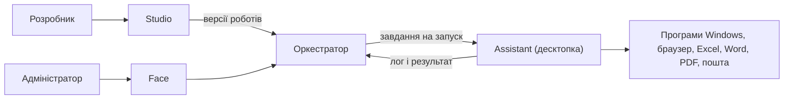

# Tekra: що вже є, як працює і що далі

> Огляд для команди · 11 листопада 2026. Онлайн-версія: https://claude.ai/artifact/Mn2iBtKD1DzZvEDyZt3Uff
>
> У тексті **Assistant** — програма на комп'ютері користувача, яку ми між собою називаємо **десктопкою**: «Assistant (десктопка)».

## 1. Що таке Tekra

Tekra — платформа для **програмних роботів** (RPA). Робот робить на комп'ютері ту саму рутину,
що й людина: відкриває програми й сайти, заповнює поля, натискає кнопки, читає таблиці Excel,
заповнює договори у Word, надсилає листи — швидше, без помилок і хоч уночі.

Типовий приклад: «взяти рахунки з Excel, для кожного внести дані в облікову систему, зробити акт у
Word, зберегти в PDF і надіслати бухгалтерії». Людина один раз показує, як це робиться, — далі
робот виконує сам за розкладом.

Tekra — не лише «робот, який клікає», а повний цикл: зробити робота, перевірити, погодити,
випустити в роботу, запускати за розкладом, стежити за станом і бачити, хто що зробив.

## 2. Із чого складається

| Частина | Для кого | Що робить |
|---|---|---|
| **Studio** | розробник, у браузері | Тут роблять роботів: кроки, елементи, перевірка, тестові запуски, компоненти, бізнес-процеси |
| **Оркестратор** | сервер, «мозок» | Зберігає роботів і версії, вирішує хто/де/коли запускає, черга, розклади, погодження, стан, журнал |
| **Face (адмінка)** | адміністратор, у браузері | Користувачі й ролі, машини, погодження, розклади, стан роботів, політики, ліцензії, сповіщення |
| **Assistant (десктопка)** | ПК користувача, Windows | Виконує роботів: вікна програм, свій браузер, Excel, Word; розклад і журнал. Версія 1.9.0 |

Вхід для всіх частин один — через **Keycloak**. Частини обмінюються повідомленнями через
**RabbitMQ**; десктопка тримає з оркестратором постійне захищене з'єднання.

## 3. Як це працює: шлях робота від ідеї до нічного запуску

1. **Адмін підключає людей і десктопку.** У Face запрошує людину з роллю (адмін, розробник,
   користувач) і надсилає **одноразове посилання для підключення**. Людина вставляє його в
   Assistant (десктопку), підтверджує й входить через браузер. У системі видно `MACHINE-1 · ASSISTANT-1`.
2. **Розробник складає робота в Studio.** Список кроків із каталогу («відкрити сайт», «ввести
   логін», «прочитати таблицю», «для кожного рядка…»); форма кожного кроку будується сама. Є
   змінні, умови, цикли, обробка помилок.
3. **Розробник показує роботу елементи.** **Inspector**: навів на кнопку у вікні чи на сторінці —
   система запам'ятовує **кілька способів знайти елемент**. Не спрацював перший — робот пробує
   наступний і підказує перезахопити.
4. **Studio перевіряє сценарій** ще до запуску: змінні, вид елементів, шляхи до файлів, адреси
   клітинок Excel, e-mail; і яку мінімальну версію десктопки потребує робот.
5. **Тестовий запуск на своїй десктопці** — **Run**, живий лог по кроках; точки зупинки з
   переглядом змінних, «до цього кроку», «лише виділене».
6. **Версія й погодження.** Кожне збереження — версія (наприклад, 184.2). Щоб піти в PROD, версію
   подають на погодження — погоджує **інша людина**; за політиками — **тестовий період**. Потім
   версія активна; можна відкликати або повернути попередню.
7. **Розклад і робота без людини.** **Тригери** у версії («щобудня о 02:00 на MACHINE-1») —
   оркестратор сам ставить запуск у чергу. Звичайний користувач запускає робочих роботів, до яких
   має доступ.
8. **Стеження й контроль.** **Здоров'я** (за останніми робочими запусками), **доступність**
   (увімкнений / призупинений / вимкнений), лог кожного запуску, резервні пошуки елементів,
   журнал подій, сповіщення адміністраторам.

## 4. Що вміє робот

| З чим | Що робить | Стан |
|---|---|---|
| Програми Windows | Вікно, клік, ввід, читання, списки, очікування, гарячі клавіші | ✅ працює |
| Вебсторінки | Власний браузер робота (системний Edge, чистий профіль): відкрити, ввести, клікнути, вибрати, прочитати текст і таблиці; завжди закривається | ✅ працює |
| Excel | Справжній Excel, прихований окремий екземпляр: усе, що відкриває Excel (xlsx, xls, xlsb, csv, ods, з паролем), запис, дописування, аркуші, формули, макроси, збереження в інших форматах і PDF | ✅ працює |
| Word | Шаблони `{{контрагент}}` → значення (з колонтитулами й таблицями), заміна тексту, читання, збереження в docx, PDF, rtf… | ✅ працює |
| PDF | Текст і таблиці, інформація, злиття, виділення сторінок; скани — ще ні | ✅ працює |
| Пошта напряму | Надсилання з вкладеннями, читання скриньки з фільтрами, позначити прочитаним, зберегти вкладення — без Outlook | ✅ працює |
| Outlook | Те саме через Outlook людини | ⚠️ не перевірено наживо |
| Логіка | Змінні, умови, цикли, помилки, паузи, журнал, параметри | ✅ працює |

На демо один робот за 27 с прочитав рахунки з Excel, зробив три акти з шаблону Word, зібрав
один PDF, надіслав листом, прочитав лист у скриньці бухгалтерії й зберіг вкладення.

## 5. Інструменти розробника в Studio

- **Редактор кроків** — дерево з блоками, форма кожного кроку, вкладка «JSON».
- **Бібліотека елементів** — де використовуються, як шукаються, знімок для перезахоплення.
- **Inspector** — для вікон Windows і вебсторінок (окреме вікно браузера, Ctrl+клік).
- **Компоненти** — готові шматки сценарію для різних роботів.
- **Бізнес-процеси** — BPMN: що робить людина, робот, система; здоров'я процесу.
- **Налагодження** — точки зупинки, пауза зі змінними, «до кроку», «виділене».
- **Облікові дані** — зашифровані, маскуються в логах, один запис — один запуск одночасно.

## 6. Контроль і безпека

- Вхід через Keycloak (двофакторний, одна політика паролів).
- Ролі: адміністратор, розробник, користувач; користувач бачить лише дозволених робочих роботів.
- Ізоляція організацій на рівні бази даних.
- Шифрування секретів, ключ на кожну організацію; паролі не віддаються через API.
- Погодження PROD — лише іншою людиною, за політиками.
- Журнал подій: хто подав, погодив, запустив, що змінилося.
- Робот не чіпає речі людини: свій браузер, свій прихований Excel і Word, закриваються після запуску.
- Черга: одна машина — один запуск; PROD — першим.

## 7. Що вже зроблено

| Фаза | Що це | Стан |
|---|---|---|
| 0. Фундамент | Studio, обмін повідомленнями, єдиний вхід, ізоляція, шифрування, журнал | ✅ |
| 1. Тонка нитка | Перший наскрізний шлях: робот → версія → запуск → результат | ✅ |
| 2. Виконавець | Десктопка виконує сценарії, програми Windows | ✅ |
| 3. Inspector | Захоплення елементів вікон, бібліотека | ✅ |
| 4. Редактор Studio | Каталог дій, форми, перевірка, облікові дані | ✅ |
| 5. Виконання | Черга, перевірки, живі логи, скасування, втрата зв'язку | ✅ |
| 6. Шлях у PROD | Версії, погодження, тестові періоди, відкат, стан, архів, доступи | ✅ |
| 7. Розклад | Тригери, автоматичні запуски | ✅ |
| 8. Компоненти, процеси, налагодження | Повторні шматки, BPMN, точки зупинки | ✅ |
| 9. Excel | Справжній Excel | ✅ |
| 9B. Word, пошта, PDF | Шаблони Word, пошта, Outlook, PDF | ✅ |
| 10. Вебсторінки | Браузер робота й Inspector для сторінок | ✅ |
| 11. 1С / BAS | Облікові системи | ⏸ на паузі |

Кожен етап закривався **живим прогоном** (справжній робот на справжній десктопці) плюс
автотести: у десктопці понад 440, окремо — зі справжнім Excel, Word, браузером і поштовим сервером.

## 8. Чого ще немає

- Outlook не перевірений наживо (немає скриньки на машині розробки).
- Дашборд Face — на даних з макета; справжній стан — сторінка «Robots».
- Скани PDF не розпізнаються.
- Інсталятор десктопки з новими можливостями не зібраний і не перевірений.
- Повністю автономні запуски на віртуальних машинах — ще ні.
- На робочих машинах Office має бути активований.

## 9. Що далі

**Найближче**
- **1С / BAS (фаза 11)** — на паузі; перед стартом окреме обговорення. Спершу розвідка на демобазі
  BAS Бухгалтерія: вікна 1С через десктопку, веб-клієнт, чи потрібен прямий доступ через API.
- **Outlook наживо** — коли буде тестова скринька.
- **Підготовка до релізу:** інсталятор на чистій машині, одна початкова міграція бази, оновлення
  фреймворку фронтендів, справжній дашборд у Face.

**Після першої версії**
- Автономні запуски на віртуальних машинах.
- Розумніша черга: блокування файлів і ліцензій, резервування часу, витіснення.
- Кілька десктопок на машині, тарифи й ліміти, маркетплейс, перехід Free → Paid.
- Розпізнавання сканів (OCR).

**Ідея на обговорення:** «AI у Tekra» — AI будує й лагодить роботів, робот виконує, людина погоджує.

## Словничок

- **Робот** — записаний сценарій дій, що виконується автоматично.
- **Assistant (десктопка)** — програма на Windows-машині, що виконує роботів.
- **Studio** — вебредактор роботів. **Face** — адмінка. **Оркестратор** — сервер-«мозок».
- **TEST / PROD** — тестовий і робочий запуск. **Версія** — знімок робота (184.2).
- **Елемент** — кнопка, поле, таблиця. **Inspector** — інструмент, яким показують елементи.
- **Тригер** — правило автозапуску. **Здоров'я** — стабільність за останніми запусками.
